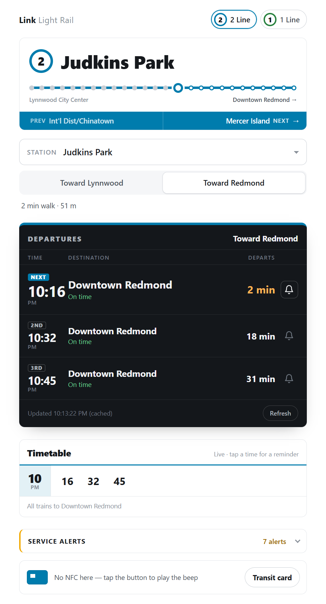
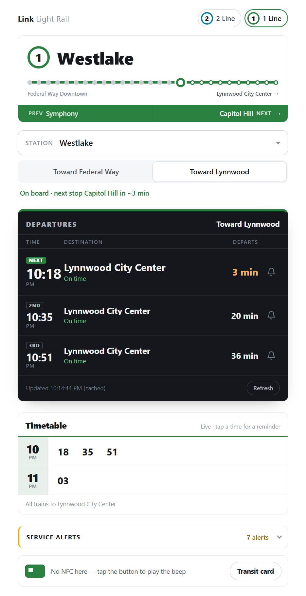
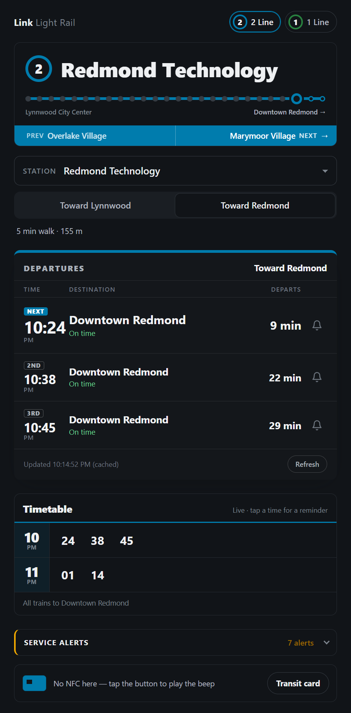

# Link Arrivals — Sound Transit Light Rail Tracker

A real-time arrival tracker for Sound Transit **1 Line** and **2 Line** light rail, built with Node.js/Express, a zero-dependency PWA frontend, and Capacitor Android/iOS shells.

Inspired by Japanese subway signage and platform departure boards, the interface pairs each station's line-colored sign and interactive route strip with a live departure board, an hour-by-hour timetable, service alerts, GPS walk-time/onboard detection, and optional transit card tap simulation.

## Screenshots

| 2 Line (Cross-Lake & Eastside) | 1 Line (Onboard Detection) | Dark Mode |
| :---: | :---: | :---: |
|  |  |  |

## Features

- **Full 1 Line & 2 Line Coverage**
  - **1 Line** (`100479`): 27 stations from **Lynnwood City Center** to **Federal Way Downtown** (including Pinehurst).
  - **2 Line** (`2LINE`): 26 stations from **Downtown Redmond** across Bellevue, **Mercer Island**, and **Judkins Park** into Seattle and **Lynnwood City Center**.
  - Route-aware filtering prevents cross-line bleed at the 14 shared stations between Int'l Dist/Chinatown and Lynnwood.
- **Japanese Subway Signage UI**
  - Station sign (`ekimeihyo`) with previous/next stop band and clickable full-line route diagram (`rosenzu`).
  - Platform departure board (`hasshahyo`) highlighting `NEXT`, `2ND`, and `3RD` trains with live on-time/delay badges.
  - Hourly timetable (`jikokuhyo`) grouped by hour with tap-to-remind notifications 2 minutes before arrival.
  - Automatic light and dark color schemes via `prefers-color-scheme`.
- **Real-Time Data Pipeline**
  - Primary feed: Sound Transit agency `40` GTFS-RT Trip Updates protobuf (`trip-updates-for-agency/40.pb`) and Service Alerts (`st-service-alerts-prod/alerts.pb`).
  - Fallback & enrichment: OneBusAway Puget Sound REST API with request pacing, retry on `429`, and 3-minute in-memory caching.
- **Location & Onboard Awareness**
  - Estimates walking time and distance to the selected station using browser geolocation.
  - Automatically switches to **On board** mode within 50 m of a station and estimates ETA to the next stop.
- **PWA & Native Mobile Shell**
  - Offline-capable Service Worker (`public/sw.js`) and web app manifest.
  - Capacitor Android/iOS projects (`android/`, `ios/`) with Android Host Card Emulation (`CardEmulationService`) and Web NFC support.

## Quick Start

### Local Development (Node.js 24+)

```bash
npm install
npm start
```

Open `http://localhost:3000`.

### Docker Compose

```bash
touch .env             # optional: add OBA_API_KEY=your_key
docker compose up -d --build
```

The container listens on port `3000` internally and is mapped to host port `30089` in `compose.yaml`.

### Environment Variables

| Variable | Default | Description |
| --- | --- | --- |
| `PORT` | `3000` | HTTP server port |
| `OBA_API_KEY` | `TEST` | OneBusAway Puget Sound API key (shared `TEST` key is rate-limited; use a personal key for heavy traffic) |

## API Endpoints

| Endpoint | Method | Description |
| --- | --- | --- |
| `/api/lines` | `GET` | List supported lines, colors, directions, and station counts |
| `/api/stations?line=2_line` | `GET` | List ordered stations and coordinates for `1_line` or `2_line` |
| `/api/arrivals/:stationId?line=2_line&direction=southbound` | `GET` | Real-time and scheduled departures for a station (`southbound` / `northbound`) |
| `/api/alerts` | `GET` | Active Sound Transit GTFS-RT service alerts |
| `/api/docs` | `GET` | JSON API summary |
| `/health` | `GET` | Health check (`{ status: "ok", timestamp }`) |

## Mobile Build (Android / iOS)

See [MOBILE_BUILD.md](MOBILE_BUILD.md) for Capacitor sync, Android APK / HCE transit card build, and iOS Xcode instructions.

```bash
npm run cap:sync
npm run cap:open:android   # or cap:open:ios
```

## Project Structure

```text
├── src/
│   └── server.js              # Express API, GTFS-RT & OneBusAway aggregator
├── public/
│   ├── index.html             # PWA entry point
│   ├── style.css              # Signage-first responsive styles (light/dark)
│   ├── app.js                 # Frontend state, board, timetable, geolocation, NFC
│   ├── sw.js                  # Service Worker
│   ├── manifest.json          # Web App Manifest
│   └── sounds/orca-scan.mp3   # Card tap chime
├── docs/screenshots/          # README screenshots
├── android/                   # Capacitor Android project (with HCE service)
├── ios/                       # Capacitor iOS project
├── capacitor.config.ts        # Capacitor configuration
├── compose.yaml               # Docker Compose definition
├── Dockerfile                 # Multi-stage non-root Alpine container
└── MOBILE_BUILD.md            # Native Android & iOS build guide
```
